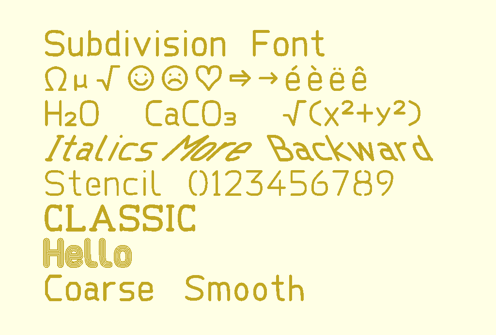
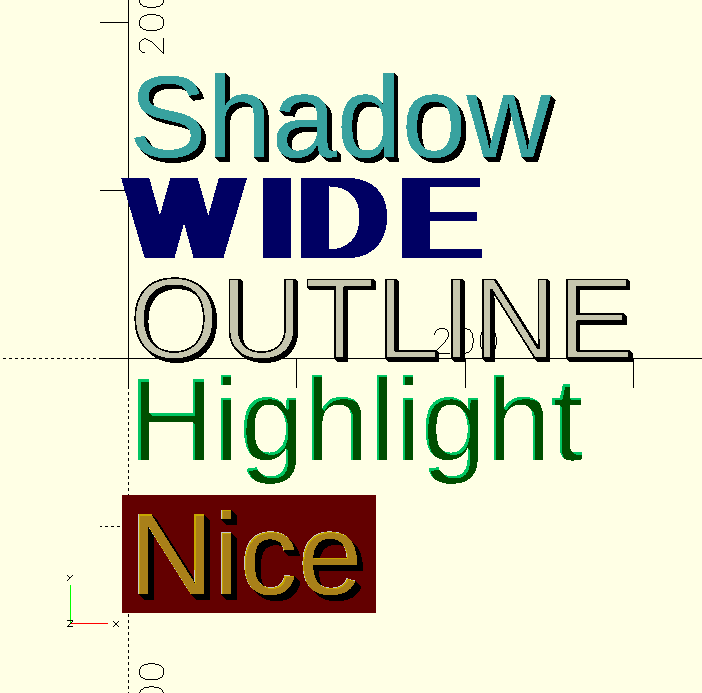
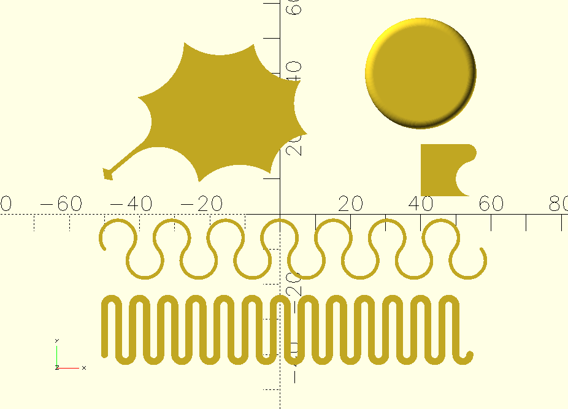
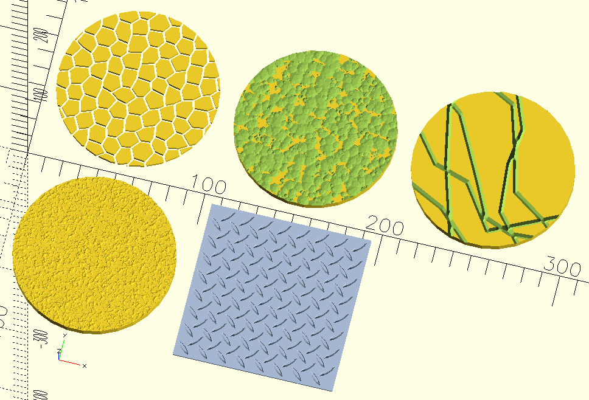
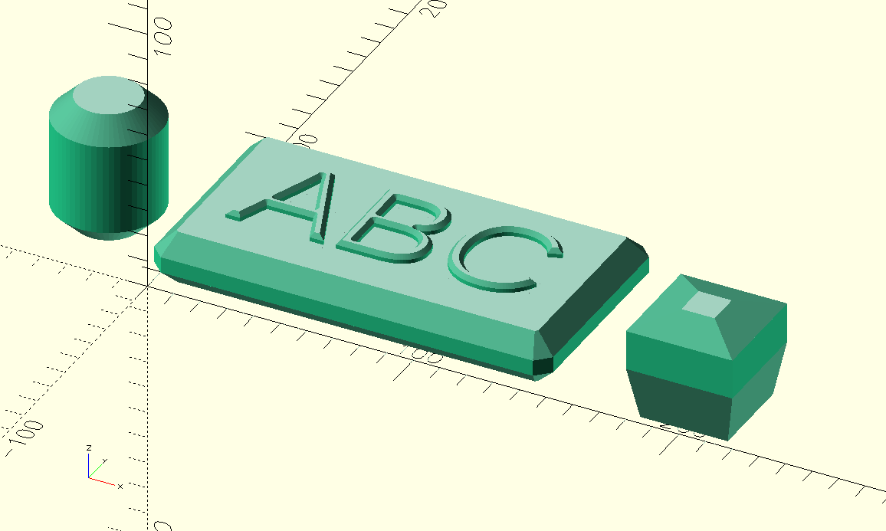
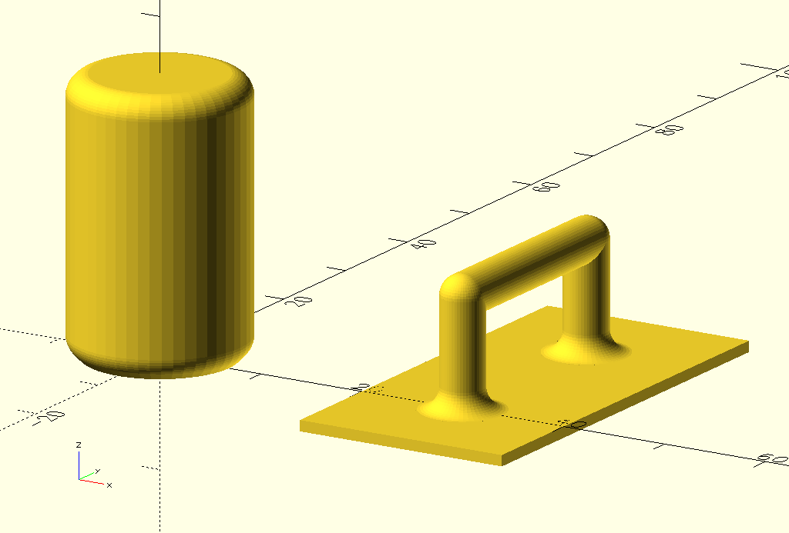
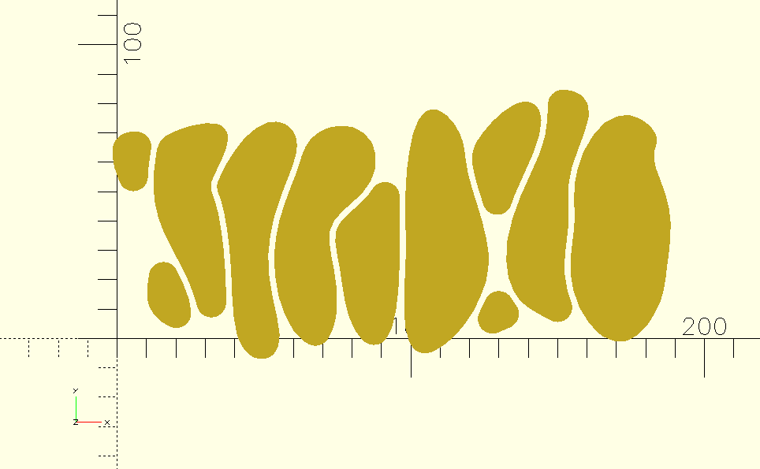

# StoneAgeLib

All sorts of scripts for OpenSCAD.  
The scripts are for 3D models for 3D printing.  
The library prioritizes practical results over mathematical correctness.

An important aspect of this library is the CC0 (Public Domain) license.

Note: When using files from this library for a project that is published, then please add those library files to your project or copy the parts of the scripts that your use into your own script. This library might change and a future version might be incompatible with your script.

This library is for a OpenSCAD version of at least 2026 with the features turned on.

## Documentation

[See the Wiki for the documentation](https://github.com/Stone-Age-Sculptor/StoneAgeLib/wiki).

## AI

Similar code as used in this library can probably be generated by AI at the end of the year 2026.  
That does not have an immediate impact on my plans with this library.    
I will try to focus on the font data and to make this library work along the BOSL2 library.
I have also a few vague ideas for new functionality, which I need to test and perhaps some of those will be added. 

## Examples

This library has a "Subdivision Font". It is created with control points and the path is made with subdivision.

A function to create a 2D shadow or highlight can make a text look better with multiple colors.

A turtle to draw a shape. Its usage is similar to the Python Turtle graphics.

Textures that are created in a random way (except the checkered steel plate).

A chamfered extrusion.

A cylinder with inward or outward fillet. An optional 45 degrees angle can be added to the bottom.

Using subdivision to create blobs.

